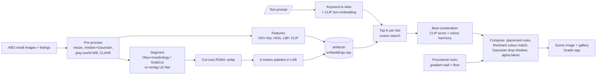

# AI-Assisted Commerce Scene Builder (2.5D)

Type an idea such as **"cozy reading corner"**. The system retrieves matching product photos from the
Amazon Berkeley Objects (ABO) dataset, cuts them out, picks a colour-harmonious combination and composes
them into a room image. College Digital Image Processing (DIP) project, Python only, runs on a free CPU Space.

> The block above between the `---` lines is the Hugging Face Space header. It is ignored by GitHub's renderer
> (shown as a small table) and is required by Spaces. Do not delete it.

## Pipeline



Offline stages (left, run once on Colab/Kaggle) produce `artifacts/`. The app only loads those files plus the CLIP text encoder.

## DIP topic mapping

| DIP topic (course) | Where | What it does |
|---|---|---|
| Image resizing / interpolation | `preprocess.resize_long_side` | bicubic up-, area down-sampling to 256 px |
| Spatial filtering (noise removal) | `preprocess.denoise` | 3x3 median + Gaussian blur |
| Colour constancy / white balance | `preprocess.gray_world` | gray-world gains from foreground pixels only (half strength) |
| Histogram processing | `preprocess.clahe_l` | CLAHE on the L channel of LAB |
| Colour spaces (RGB, HSV, LAB) | `features.hsv_hist`, `palette`, `compose.reinhard` | HSV histogram, LAB k-means, LAB colour transfer |
| Thresholding | `segment.otsu_mask` | Otsu on distance-to-background-colour |
| Morphology | `segment._clean` | opening, closing, largest component, hole filling |
| Segmentation (interactive/graph cut) | `segment.grabcut_mask` | GrabCut fallback when Otsu fails |
| Deep segmentation | `segment.rembg_mask` | U2-Net (pre-trained, used as pseudo ground truth) |
| Feature extraction: colour, shape, texture | `features` | HSV histogram, HOG, LBP vs CLIP |
| Image retrieval, evaluation | `index`, `eval` | cosine search, NDCG@10 |
| Clustering / palettes | `palette.dominant_colors` | k-means (k=3..5 by silhouette) in LAB |
| Geometric transforms | `compose.place` | scaling, flipping, perspective-style squash of rugs |
| Alpha compositing | `compose.blend` | RGBA alpha blending |
| Blurring for effects | `compose.drop_shadow` | Gaussian-blurred contact shadows |
| Colour transfer | `compose.reinhard` | Reinhard mean/std matching to the room (25 % strength) |
| Procedural image synthesis | `compose.make_room` | gradient wall, wooden floor, vignette, film grain |

## Repository layout

```
app.py                  Gradio app (Hugging Face Space entry point)
src/data.py             download ABO metadata + small images -> data/meta.csv
src/preprocess.py       classical DIP enhancement
src/segment.py          classical vs rembg segmentation, IoU, cut-outs
src/features.py         HSV hist, HOG, LBP, OpenCLIP ViT-B/32
src/index.py            cosine-similarity index (same interface for all features)
src/palette.py          k-means palettes + colour-harmony score
src/compose.py          prompt -> slots -> scene
src/build.py            runs enhance -> segment -> cutout -> features for all images
src/eval.py             metrics + figures
notebooks/run_all.ipynb Colab/Kaggle runner
artifacts/              embeddings.npy, meta.csv, palettes.npz, cutouts/*.webp  (shipped to the Space)
results/                metrics.json, ndcg_table.csv, iou.json, scene_eval.csv, figures/
report_draft.md         report skeleton
```

## How to run

**Local, tiny smoke test (CPU, a few minutes, low RAM):**
```bash
pip install -r requirements-build.txt
python -m src.data  --per-cat 6 --out data_test
REMBG_MODEL=u2netp python -m src.build --data data_test --out artifacts_test
python -m src.palette --art artifacts_test
python -m src.eval --data data_test --art artifacts_test
ART_DIR=artifacts_test python app.py
```

**Full run (recommended on Colab/Kaggle T4):** open `notebooks/run_all.ipynb`, set `REPO_URL`, *Run all*.
It downloads ~1520 small images, builds `artifacts/` and `results/` and offers `outputs.zip`.
Unzip it into the repo root. Cut-outs are ~256 px webp files; total `artifacts/` should be well under 100 MB.

## Deploy on Hugging Face Spaces (free CPU)

1. Create an account on huggingface.co -> *New Space* -> name `dip-scene-builder`, SDK **Gradio**, hardware **CPU basic (free)**.
2. Clone the Space repo: `git clone https://huggingface.co/spaces/<user>/dip-scene-builder` (use a HF access token with *write* role as password).
3. Copy into it: `app.py`, `src/`, `requirements.txt`, `README.md` (with the header above) and the whole `artifacts/` folder **without** `artifacts/masks/`.
   (Do not copy `data/`, `notebooks/` or `results/` unless you want them there; figures are small, they are fine.)
4. `git add . && git commit -m "deploy" && git push`. The Space builds (~3-5 min) and starts; the first start downloads the
   CLIP text/vision weights (~340 MB) from the Hub, afterwards the app is ready in well under 60 s (about 8 s measured locally with cached weights).
5. If a file is larger than 10 MB, use `git lfs track "*.npy"` before committing. `embeddings.npy` (~3 MB for 1520 x 512 float32) does not need it.

## Honest notes / limitations

* ABO "small" images are tiny (<= 256 px, many ~100 px), so cut-outs are soft and upscaled in the scene.
* **rembg is pseudo ground truth.** ABO small images have no human masks, so IoU(classical, rembg) measures *agreement* with a strong
  model, not true accuracy; rembg is wrong on some images itself.
* **NDCG@10 is category-based.** All images in the same category are "relevant", so it measures category retrieval, not style or price
  relevance. Colour harmony re-ranks *within* a category, so it cannot move NDCG much and is evaluated with a separate palette score.
* **Harmony evaluation is partly circular.** The harmony-ON combination maximises the same compatibility score that is reported.
  We therefore also report hue spread and CLIP relevance (the cost of harmony) in `results/scene_eval.csv`.
* Many products have neutral colours (white, grey, black, brown), which the harmony rule treats as compatible with everything, so differences are small.
* Gray-world white balance can shift the colour of single-colour products; it is applied at half strength for that reason.
* The scene is 2.5D (flat cut-outs, fixed camera); no real 3D geometry is used. Future work: GLB export.

## Credits and references

* **Amazon Berkeley Objects (ABO)**: Collins et al., *ABO: Dataset and Benchmarks for Real-World 3D Object Understanding*, CVPR 2022. CC BY-NC 4.0. https://amazon-berkeley-objects.s3.amazonaws.com/index.html
* **OpenCLIP** (https://github.com/mlfoundations/open_clip) and **CLIP**: Radford et al., *Learning Transferable Visual Models From Natural Language Supervision*, ICML 2021.
* **rembg** (https://github.com/danielgatis/rembg) wrapping **U2-Net**: Qin et al., *U2-Net: Going Deeper with Nested U-Structure for Salient Object Detection*, Pattern Recognition 2020.
* **GrabCut**: Rother, Kolmogorov, Blake, *"GrabCut": Interactive Foreground Extraction using Iterated Graph Cuts*, SIGGRAPH 2004 (OpenCV implementation).
* **CLAHE**: Zuiderveld, *Contrast Limited Adaptive Histogram Equalization*, Graphics Gems IV, 1994 (OpenCV).
* **Reinhard colour transfer**: Reinhard et al., *Color Transfer between Images*, IEEE CG&A 2001.
* **HOG**: Dalal and Triggs, CVPR 2005; **LBP**: Ojala et al., TPAMI 2002 (both via scikit-image).
* OpenCV, scikit-learn, scikit-image, NumPy, pandas, Gradio.

Data licence: ABO images are CC BY-NC 4.0; this is a non-commercial course project.
