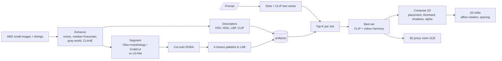

# Digital Image Processing demonstration: composing a room from catalogue photos

A Digital Image Processing (DIP 3-0-2) project. It is organised **by the course syllabus**: every module has at least
one operation that runs in the pipeline and can be seen in the app. The "product" (type *cozy reading corner*, get a
room built from real Amazon Berkeley Objects photos) is only the vehicle that makes these operations visible.

> The block above between the `---` lines is the Hugging Face Space header. It is ignored by GitHub's renderer
> (shown as a small table) and is required by Spaces. Do not delete it.

## Run the whole pipeline with one command

```bash
python run_demo.py                       # prints every stage with timings (about 30 s), saves pictures to results/demo/, opens the app
python run_demo.py "modern living room"  # another prompt
python run_demo.py --no-app              # printout only
python run_demo.py --rebuild             # also re-run the full offline build first (src.data, build, palette, eval; slow)
```

Stages shown live: 1 enhancement, 2 segmentation (Otsu vs U2-Net, IoU), 3 descriptors and palette, 4 CLIP retrieval and colour-harmony
search, 5 2D composition, 6 2D geometric edits (affine rotation and spacing, with the matrices), 7 3D export.

## Syllabus module, the operation that demonstrates it, and where to see it

Source: *Digital Image Processing 3-0-2, Course Structure 2026-27* (Gonzalez and Woods 4th ed. as primary text, Szeliski as companion).

| Module | Syllabus topics used | Operation in this project | See it |
|---|---|---|---|
| **M1** Introduction (Ch. 1-2) | pixels, resolution, sampling, quantisation, representation | 100-256 px source photos; bicubic and area resampling (`preprocess.resize_long_side`); 8-bit RGB and RGBA arrays. **Geometric spatial transformations and interpolation** (Ch. 2): affine rotation, translation and scaling with bilinear interpolation (`edit2d.rotate_rgba`, `compose.make_layer`). The syllabus table does not list geometric transformations as a separate topic; they come from the Ch. 2 content of this module | app: *2D geometric edits*; `run_demo.py` stage 6 |
| **M2** Spatial enhancement (Ch. 3) | histogram equalisation, intensity transforms, image arithmetic | CLAHE on the L channel (`preprocess.clahe_l`); gray-world gains with clipping (`preprocess.gray_world`); alpha compositing as image arithmetic (`compose.blend`). Not used: log, gamma | `run_demo.py` stage 1; `results/figures/fig1_pipeline_stages.png` |
| **M3** Spatial filtering (Ch. 3) | smoothing, median, Gaussian, noise, gradients | 3x3 median and Gaussian denoising (`preprocess.denoise`); Gaussian-blurred contact shadows (`compose.drop_shadow`); gradient filters inside HOG. Not used: sharpening, Laplacian | stage 1; shadows in every scene |
| **M4** Frequency domain (Ch. 4) | Fourier transform, FFT, frequency filters | **Not implemented.** A Gaussian blur is a Gaussian low-pass filter, so our denoising is low-pass filtering done in the spatial domain. An FFT study of the photos is future work | none |
| **M5** Colour and morphology | RGB, HSV, Lab; opening, closing | HSV histogram (`features.hsv_hist`); CIELAB k-means palettes (`palette`); Reinhard colour transfer (`compose.reinhard`); opening, closing, largest component, hole filling (`segment._clean`). Chapter numbers: the textbook list gives colour as Ch. 7 and morphology as Ch. 9 (the module table prints "Ch. 6 and 9") | `results/figures/fig5_palettes.png`; stage 2 |
| **M6** Features (Ch. 10-11, Szeliski) | texture and shape features, feature matching | HSV histogram, HOG (edges, shape), LBP (texture), cosine matching (`features`, `index`). Not used: Canny, Harris, SIFT, ORB | `results/figures/fig3_ndcg.png`; stage 3 |
| **M7** Segmentation (Ch. 10) | thresholding, Otsu, k-means segmentation | Otsu on distance from the background colour (`segment.otsu_mask`); GrabCut graph cut (`segment.grabcut_mask`); k-means of pixels in LAB (`palette.dominant_colors`). Not used: region growing, watershed | `results/figures/fig2_masks_iou.png`; stage 2 |
| **M8** ML for images | unsupervised learning, KNN, clustering | k-means with silhouette score for k; nearest-neighbour search (`index.search`). No trained classifier | stage 3 and 4 |
| **M9** Deep learning | CNN, semantic segmentation (U-Net) | U2-Net encoder-decoder cut-outs through rembg (`segment.rembg_mask`), used pre-trained, as a reference mask | stage 2 |
| **M10** ViT, multimodal vision | ViT, CLIP | OpenCLIP ViT-B/32 image and text embeddings drive all retrieval (`features.load_clip`). No video | stage 4 |

Labs that line up with this project: 2 (histograms), 3 (filtering), 6 (colour), 7 (morphology), 8 (features), 9 (segmentation), 10 (classical ML), 11 (CNN), 12 (ViT).
The syllabus labs 1-10 are MATLAB; this project uses Python with OpenCV, scikit-image and scikit-learn, which the syllabus lists as references.

## Chair backrest editing (current app)

The current editor changes a **selected backrest region**, not the orientation of the whole chair picture.
Build a reading corner, home office or dining room, select a chair, choose **90° / 135° / 180°** (or an intermediate preset),
then click **Apply 2D changes**. 90° restores the original photo. The seat and legs below the hinge keep their original
pixels and canvas position, unless spacing explicitly translates the chair.

Open **Adjust backrest region** to set the hinge height, left/right mask edges and recline direction.
Turn on **Show transformations** to inspect the cyan region and orange hinge line before editing.
The controls are guided: the catalogue has object masks, not labelled chair-part masks, so the initial rectangle is
an estimate and can include arms or miss part of the backrest. Side-view chairs give the clearest result.

Implementation: `src/backrest.py` partitions the RGBA image into moving and fixed regions, shears and compresses only
the backrest with `cv2.warpAffine`, and composites it over the unchanged base using premultiplied alpha.
The hinge line stays fixed. At 180° a small projected thickness prevents a singular warp. The renderer preserves the
base coordinates even when the moving backrest expands the cutout bounds. Spacing is still measured after deformation.
There is no CLIP inference, segmentation, training, GPU request or 3D export in this editing callback.

**Limit:** these values control a projected 2D deformation relative to the source photo. They are not recovered physical
seat/back angles, a new viewpoint, or a mechanically accurate recliner simulation. Hidden surfaces cannot be recovered
by this operation. The 3D view remains unchanged.

Focused verification:
```
python scripts/check_backrest.py
python scripts/check_backrest_render.py
```
The latter uses a real cached chair and saves 90°/135°/180° comparisons and measured CPU render timings in `results/backrest/`.

## Historical whole-image rotation experiment (superseded UI)

The following screenshots and measurements document the previous whole-cutout rotation feature, not the current
backrest control. The generic rotation helper remains for the original demonstration scripts; it is not exposed as
the chair-angle control in the app. Use the backrest checks above for the current feature.

After **Build scene** the app keeps the chosen products in `gr.State`. The *2D geometric edits* panel then changes only the 2D picture and
never calls CLIP, the harmony search, segmentation or the 3D export (`Apply 2D changes` runs only the operations below).


*Left: generated scene. Right: chair rotated 90 degrees, shelf/lamp gap set to 440 px, with "Show transformations" on (boxes, angle, measured gap).*


### What each control does, in DIP terms

1. **Translation (spacing).** Object 1 stays fixed. Object 2 is translated horizontally so that the distance between the
   *opaque foreground bounding boxes* (alpha > 128, after scaling and rotation, ignoring transparent borders) equals the requested number of pixels:
   `B.left = A.right + gap` (or `B.right = A.left - gap` if B is left of A). The vertical position and the left/right order are kept.
   The feasible range comes from the canvas: `0 <= gap <= W - width(B) - A.right`. If the request does not fit, the nearest feasible gap is used and **reported**
   (e.g. requested 700 px, achieved 532 px); if even 0 does not fit the negative number is the overlap.
2. **Rotation (affine transform).** `M = cv2.getRotationMatrix2D(centre, angle, 1)` is a 2x3 matrix `[R | t]`. The output rectangle is enlarged with the
   `|cos|, |sin|` formula and `t` is shifted, so nothing is cropped; `cv2.warpAffine` applies it with bilinear interpolation, transparent borders and empty margins trimmed.
   Allowed angles: 0, 45, 90, 135, 180 degrees counter-clockwise (OpenCV convention). 0 degrees keeps the original image pixel for pixel.
3. **Interpolation and premultiplied alpha.** Bilinear interpolation averages neighbouring pixels. If transparent pixels carry an arbitrary colour (white, black), that
   colour leaks into the edge and makes a halo. So colour is multiplied by alpha before warping and divided afterwards. Each edit starts again from the cached
   *source* cut-out, never from a previous result, so repeated edits do not accumulate blur.
4. **Alpha compositing and shadows.** The rotated RGBA layer is blended with `out = fg * a + bg * (1 - a)`. The contact shadow is regenerated from the *transformed* alpha mask (an ellipse under the opaque feet, Gaussian-blurred).
5. **Grounding.** A rotated object is placed so the bottom of its opaque box sits on the original floor line, kept inside the canvas. A box larger than the canvas is centred and the app says so.

"Show transformations" adds the opaque boxes, the angle and the gap measurement to the picture, a before/after cut-out strip on a checkerboard, and (in the *Affine matrices* panel) the
actual matrices: the 2x3 rotation matrix used by `warpAffine`, and the net 2x3 matrix from the source cut-out to the canvas (flip, scale, rotation, translation).


### What was measured (`python scripts/verify_2d.py`, numbers in `results/presentation_2d/measurements.json`)

| Check | Result |
|---|---|
| Spacing shelf / lamp (feasible range 0-532 px, default gap 346 px) | requested 60 -> measured 60 px; requested 240 -> measured 240 px; requested 700 -> feasible 532 px reported and measured |
| Gap measured from pixels for **all 56 ordered pairs of the 8 classes** | 56 of 56 equal the reported gap |
| Unrelated objects when spacing is applied | boxes unchanged |
| Rotation of every class (24 checks: 8 classes x 90, 135, 180 degrees) | 22 inside the canvas; 2 outside and flagged "larger than the canvas" (one 592 px wide shelf at 90 and 135 degrees); opaque area stays within 0.982-1.003 of the original (nothing cropped) |
| Chair at 0/45/90/135/180 degrees | opaque area ratio 1.000 / 1.001 / 0.999 / 1.001 / 0.999; corners fully transparent |
| Default (no edit) | output identical to the generated image; also identical to the previous renderer on 6 room templates x 3 random product sets |
| Rotate to 135 degrees and back to 0 | image identical to the original; the source cut-out array is unchanged |
| Halo test, synthetic red disc on white-coloured transparent pixels, 45 degrees | edge colour error 0.0 (premultiplied) vs 87.4 (straight alpha). On a real chair the two agree, because real cut-outs carry neutral colour under transparent pixels |
| Edit callback with CLIP, harmony search, rembg and the 3D export replaced by functions that raise | completes without calling any of them |
| Latency, edit callback (renders both harmony images, builds the PNG, overlay, matrices), CPU laptop | median 89 ms, max 215 ms over 30 varied edits; first edit with empty caches 692 ms; the render alone 17 ms |
| Latency in the real UI (Gradio 6.20.0 in Edge) | 254-302 ms inside the callback; 0.7-0.9 s from click to updated page |

### Limits of this extension

* The rotation is an **image-plane rotation of a flat cut-out**. It is not a new viewpoint of the chair and not a 3D reconstruction. Rotated chairs look odd by design.
* Spacing is horizontal only and defined on opaque bounding boxes, so it measures box edges, not the true shape-to-shape distance.
* The controls are 2D only. The 3D view is not changed by them.
* Rugs are already squashed to look flat; rotating them (allowed for all 8 classes) gives a rotated flat rug, nothing more.
* The shelf/lamp pair needs both objects in the room; otherwise the first two floor objects are the default, and rooms with a single object disable spacing with a message.

## Pipeline



Offline stages (left, run once on Colab/Kaggle) produce `artifacts/`. The app only loads those files plus the CLIP text encoder.

## Repository layout

```
run_demo.py             ONE command: runs and times the whole pipeline live, then opens the app
app.py                  Gradio app (Hugging Face Space entry point)
src/data.py             download ABO metadata + small images -> data/meta.csv
src/preprocess.py       classical DIP enhancement
src/segment.py          classical vs rembg segmentation, IoU, cut-outs
src/features.py         HSV hist, HOG, LBP, OpenCLIP ViT-B/32
src/index.py            cosine-similarity index (same interface for all features)
src/palette.py          k-means palettes + colour-harmony score
src/compose.py          prompt -> slots -> scene; placement, shadows, blending, 2D edits (render_scene)
src/edit2d.py           affine rotation (premultiplied alpha), opaque bounding box, spacing solver
src/scene3d.py          3D proxy room exported as GLB
src/build.py            runs enhance -> segment -> cutout -> features for all images
src/eval.py             metrics + figures
notebooks/run_all.ipynb Colab/Kaggle runner
artifacts/              embeddings.npy, meta.csv, palettes.npz, cutouts/*.webp  (shipped to the Space)
results/                metrics.json, ndcg_table.csv, iou.json, scene_eval.csv, figures/
scripts/verify_2d.py    focused check of the 2D edits; writes results/presentation_2d/
report_draft.md         report skeleton
```

## How to run

**Local, tiny smoke test (CPU, a few minutes, low RAM):**
```bash
pip install -r requirements-build.txt
python -m src.data  --per-cat 6 --out data_test
REMBG_MODEL=u2netp python -m src.build --data data_test --out artifacts_test
python -m src.palette --art artifacts_test
python -m src.eval --data data_test --art artifacts_test
ART_DIR=artifacts_test python app.py
```

**Full run (recommended on Colab/Kaggle T4):** open `notebooks/run_all.ipynb`, set `REPO_URL`, *Run all*.
It downloads ~1520 small images, builds `artifacts/` and `results/` and offers `outputs.zip`.
Unzip it into the repo root. Cut-outs are ~256 px webp files; total `artifacts/` should be well under 100 MB.

## Deploy on Hugging Face Spaces (free CPU)

1. Create an account on huggingface.co -> *New Space* -> name `dip-scene-builder`, SDK **Gradio**, hardware **CPU basic (free)**.
2. Clone the Space repo: `git clone https://huggingface.co/spaces/<user>/dip-scene-builder` (use a HF access token with *write* role as password).
3. Copy into it: `app.py`, `src/`, `requirements.txt`, `README.md` (with the header above) and the whole `artifacts/` folder **without** `artifacts/masks/`.
   (Do not copy `data/`, `notebooks/` or `results/` unless you want them there; figures are small, they are fine.)
4. `git add . && git commit -m "deploy" && git push`. The Space builds (~3-5 min) and starts; the first start downloads the
   CLIP text/vision weights (~340 MB) from the Hub, afterwards the app is ready in well under 60 s (about 8 s measured locally with cached weights).
5. If a file is larger than 10 MB, use `git lfs track "*.npy"` before committing. `embeddings.npy` (~3 MB for 1520 x 512 float32) does not need it.

## Honest notes / limitations

* ABO "small" images are tiny (<= 256 px, many ~100 px), so cut-outs are soft and upscaled in the scene.
* **rembg is pseudo ground truth.** ABO small images have no human masks, so IoU(classical, rembg) measures *agreement* with a strong
  model, not true accuracy; rembg is wrong on some images itself.
* **NDCG@10 is category-based.** All images in the same category are "relevant", so it measures category retrieval, not style or price
  relevance. Colour harmony re-ranks *within* a category, so it cannot move NDCG much and is evaluated with a separate palette score.
* **Harmony evaluation is partly circular.** The harmony-ON combination maximises the same compatibility score that is reported.
  We therefore also report hue spread and CLIP relevance (the cost of harmony) in `results/scene_eval.csv`.
* Many products have neutral colours (white, grey, black, brown), which the harmony rule treats as compatible with everything, so differences are small.
* Gray-world white balance can shift the colour of single-colour products; it is applied at half strength for that reason.
* The 2D scene is flat cut-outs with a fixed camera. The 3D room is **proxy geometry** (boxes, cylinders, spheres coloured from the chosen products); it is not a reconstruction of the photographed products.
* The 2D rotation control is an image-plane rotation, not a new viewpoint. The frequency-domain module (M4) is not covered.

## Credits and references

* **Amazon Berkeley Objects (ABO)**: Collins et al., *ABO: Dataset and Benchmarks for Real-World 3D Object Understanding*, CVPR 2022. CC BY-NC 4.0. https://amazon-berkeley-objects.s3.amazonaws.com/index.html
* **OpenCLIP** (https://github.com/mlfoundations/open_clip) and **CLIP**: Radford et al., *Learning Transferable Visual Models From Natural Language Supervision*, ICML 2021.
* **rembg** (https://github.com/danielgatis/rembg) wrapping **U2-Net**: Qin et al., *U2-Net: Going Deeper with Nested U-Structure for Salient Object Detection*, Pattern Recognition 2020.
* **GrabCut**: Rother, Kolmogorov, Blake, *"GrabCut": Interactive Foreground Extraction using Iterated Graph Cuts*, SIGGRAPH 2004 (OpenCV implementation).
* **CLAHE**: Zuiderveld, *Contrast Limited Adaptive Histogram Equalization*, Graphics Gems IV, 1994 (OpenCV).
* **Reinhard colour transfer**: Reinhard et al., *Color Transfer between Images*, IEEE CG&A 2001.
* **HOG**: Dalal and Triggs, CVPR 2005; **LBP**: Ojala et al., TPAMI 2002 (both via scikit-image).
* OpenCV, scikit-learn, scikit-image, NumPy, pandas, Gradio.

Data licence: ABO images are CC BY-NC 4.0; this is a non-commercial course project.
